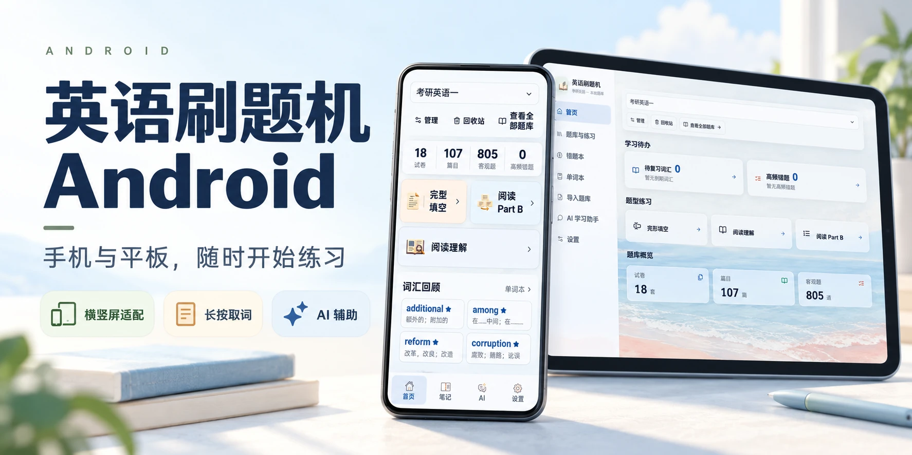

<div align="center">

  

  # English Practice Machine Android

  **Open question banks · Your models · Local data · Free practice**

  An Android app for sustained English multiple-choice practice

  <p>
    <a href="README.md">中文</a> ·
    <a href="docs/question-bank-format.md">ESQ format</a> ·
    <a href="docs/update-manifest.md">Update manifest</a> ·
    <a href="LICENSE">GPL-3.0-only</a>
  </p>

  <p>
    <a href="https://linux.do/" target="_blank" rel="noopener noreferrer"></a>
    
    
    
    
  </p>

  <p>
    <a href="#sponsor"></a>
    <a href="#support"></a>
  </p>
</div>

English Practice Machine Android is an independent release line derived from the Windows edition. It keeps your banks, models, and practice history on your own device. Import the banks you choose, connect the AI provider you choose, and keep practice fresh with complete passages, shuffled options, and wrong-answer retries instead of memorising answer positions.

## Download 1.0.1

| Platform | Version | Get it |
| --- | --- | --- |
| Android phone / tablet | 1.0.1 | [APK](https://github.com/wssfk12138/android-english-multiple-choice-practice-machine/releases/download/v1.0.1/english-practice-machine-android-1.0.1.apk) · [Release notes](https://github.com/wssfk12138/android-english-multiple-choice-practice-machine/releases/tag/v1.0.1) |
| Windows 10 / 11 | 1.0.1 | [Installer](https://github.com/wssfk12138/english-multiple-choice-practice-machine/releases/download/v1.0.1/EnglishPracticeMachinePublic-1.0.1-Setup.exe) · [Portable ZIP](https://github.com/wssfk12138/english-multiple-choice-practice-machine/releases/download/v1.0.1/english-practice-machine-windows.zip) |

> **Fixed in 1.0.1:** leaving an unanswered listening unit while the timer was active could keep the practice page open after confirming “continue exiting”. It now returns to the bank on both Windows and Android.

The Android build requires Android 8.0 or newer. Updating in place keeps local banks and study history; switching from a build signed with a different key may require uninstalling the old package first. The in-app updater verifies size and SHA-256 before handing the file to Android's installer.

## Two layouts for portrait and landscape

The Android edition does not shrink a desktop page. It changes information density with window width and orientation: tablets in landscape get a sidebar and two-pane practice, while phones and narrow windows use a portrait information architecture and tablets can also use split screen.

- **Four bottom destinations**: Home, Notes, AI, and Settings. Wrong answers and vocabulary live under Notes; imports, recycle bin, updates, and model configuration live under Settings.
- **A bank-aware home page**: only the Listening, Cloze, Reading, and Part B entry points that exist in the active bank appear. Paper lists show names only, and the vocabulary ticker flips every five seconds.
- **Portrait practice panes**: passage or listening controls above, questions and options below, independently scrollable with a draggable divider.
- **Landscape practice panes**: passage or material on the left, questions and options on the right, with a full-track listening player.
- **One theme across orientations**: light mode uses a warm rice-paper texture, dark mode a blue-violet night sky; phones and tablets share 4K backgrounds with centred cropping.
- **Compact toolbar**: exit, timer, answer card, and more actions use icon buttons; the answer card opens from the top and submission stays at the bottom.
- **Feedback within reach**: both Help & About in Settings and Updates & Remote Banks expose the problem-feedback button; the updates page also keeps the GitHub project entry.

## Screenshots

The landscape images come from a real desktop run of the same interface and share the sidebar and two-pane layout used by Android tablets in landscape. The portrait images come from a real Android 1.0.1 device with the system status bar and system navigation bar cropped away. They show interface and count summaries only, with no question content, API keys, sync passwords, or database files.

### Landscape

<table>
  <tr>
    <td align="center"><br><sub>Home · sidebar and study overview</sub></td>
    <td align="center"><br><sub>Import · documents, ESQ, and export</sub></td>
  </tr>
</table>

### Portrait

<table>
  <tr>
    <td align="center"><br><sub>Home</sub></td>
    <td align="center"><br><sub>Notes</sub></td>
    <td align="center"><br><sub>Settings and feedback</sub></td>
    <td align="center"><br><sub>Updates and GitHub entry</sub></td>
  </tr>
</table>

## Features

| Area | What you can do |
| --- | --- |
| Banks and import | Import ESQ 1.0/1.1, DOC, DOCX, text-based PDF, and listening audio. The model edits a structured draft only; every field is reviewed before publication |
| Practice and grading | Practice by year or a random complete unit; cloze, reading, Part B, CET word-bank and paragraph matching; shuffle options while grading uses stable keys |
| Timer and resume | Optional timer and pause; submission locates the first unanswered question; unfinished sessions resume against the same bank, unit, and question set |
| Wrong answers | Organised by bank, year, and unit with choice history, frequent mistakes, and retry snapshots; analysis is cached locally and refreshed only after a retry |
| Vocabulary | Long-press a word or phrase in a passage, stem, or option; ordinary and contextual meanings stay separate; review, edit, retry translation, and optional synonym/antonym/similar-form panels |
| AI assistant | Multiple API profiles, model discovery and switching, study chat, vocabulary translation, wrong-answer advice, import correction, and labeling; up to four image attachments |
| Local data | Banks, practice, wrong answers, vocabulary, chats, and settings stay on the device; API keys use Android Keystore/AES-GCM |
| Updates and privacy | Check GitHub Releases, verify size and SHA-256, then hand the file to Android's installer; diagnostics stay local and support redacted export |

### Question banks and import

- English I and English II postgraduate objective-question ESQ banks are bundled for offline first use.
- A one-time onboarding prompts you to configure a model and API, then fetch additional banks from Updates; built-in or locally imported banks work without AI.
- Import, preview, validate, and conflict-check ESQ 1.0/1.1 packages.
- Import DOC, DOCX, text-based PDF question/answer files, and MP3/M4A/WAV/OGG listening tracks.
- Optional model assistance aligns question boundaries, numbers, and answer keys. The model edits a structured draft only; the user reviews fields and explicitly approves publication.
- After publication, run AI labeling for this import, a year, or the whole bank. Listening questions are excluded from labeling.
- Scanned or heavily watermarked PDFs without a reliable text layer are rejected with an OCR/manual-processing message.
- The public importer accepts one paper per import and warns before processing; later papers in a multi-paper document are ignored.
- After choosing a local file or remote bank, you must confirm whether to create a new bank profile or import into an existing one; a new profile does not silently replace the active study bank, and previews can be closed without changes.

### Practice and grading

- Practice by bank profile and year, or draw a complete unit: one cloze passage, one reading passage, or one Part B material with its questions.
- Postgraduate cloze/reading/Part B, CET word-bank and paragraph matching, and listening objective questions are supported.
- Choose option shuffling before practice; stable internal keys keep grading correct.
- Optional timer; the pause control pauses only the timer. Incomplete submissions are blocked and navigate to the first unanswered question.
- Unit submission shows unit score and wrong count; whole-paper submission shows the paper score and unit breakdown.
- Listening never reveals the transcript and is excluded from wrong-answer analysis. Audio plays as a complete track and submits as one section; leaving an unfinished section warns that the attempt will not be kept.
- Normal practice, wrong-answer retries, and synced unfinished sessions can all resume; recovery matches the same bank, unit, and question set so records from another profile are not attached by mistake.

### Wrong answers and vocabulary

- Wrong answers follow the active bank and preserve choice history, recent weighting, frequent mistakes, and redo snapshots. Reviewing a mistake does not reveal the correct answer in the question view.
- Analysis reports are cached locally. A unit cannot be analyzed again until its next wrong-question retry is completed; the next report receives the previous wrong-choice snapshot.
- Long-press a word or phrase in a passage, stem, or option to save it. Capture never shows a translation; leaving practice or opening Vocabulary queues pending entries for background translation.
- Ordinary meaning is primary, while contextual meaning sits beside “Seen in the original”. Repeated captures (two or more) receive a `🌟` marker.
- Search, filters, editing, retry, staged review, and optional synonym/antonym/similar-form comparisons are available. Relation panels are off by default and controlled globally in Settings.

### AI and model profiles

- Store multiple API profiles with endpoint, API key, default model, Temperature, enabled state, and model-selector visibility.
- Six protocol adapters are built in: `openai-chat`, `openai-responses`, `anthropic`, `google`, `kiro`, and `command-code`. They translate messages, image attachments, reasoning effort, and response text for each protocol.
- Fetch available models automatically and switch models in the assistant. Ollama, LM Studio, and similar services can use the appropriate OpenAI protocol; exact capabilities depend on the selected service and model.
- AI workflows include study chat, vocabulary translation, wrong-answer advice, import-draft correction, and question-skill labeling.
- The assistant accepts up to four compressed image attachments per message. Attachments remain in local conversation history, and unsupported image inputs produce an explicit error.
- Keys are protected by Android Keystore/AES-GCM. Core practice and grading remain offline without AI.

Current verification covers local request/response contracts for all six protocols, reasoning-effort mapping, and the frontend build. No requests have yet been sent to live endpoints for all six provider families, so this is not a claim of end-to-end provider certification.

### LAN study-record sync

- Sync practice, wrong answers, and vocabulary with a Windows copy on the same LAN; bank content still travels separately as ESQ packages.
- The Windows sync host is off by default. Android can pair only after the user enables the host and generates a password; every handshake must present the current password, rotating it invalidates old tokens, and devices can be explicitly revoked and paired again.
- Sync is isolated by bank profile and uses incremental cursors, deletion tombstones, and transactional batches. An interrupted transfer can resume, and conflicts are resolved by latest update time.
- Addresses, passwords, and device tokens stay on the user's machine and are never written into app defaults or shared bank packages.

### Updates and privacy

- The updater reads the official GitHub Release manifest; controlled HTTPS mirrors can only be supplied by a release build and are tried in order after the official source. The source default mirror list is empty.
- A download must pass its size and SHA-256 checks before Android's installer is opened; the app never installs silently.
- Application updates, the official bank catalog, and user-supplied third-party catalogs are isolated; a third-party catalog never becomes an official fallback.
- Diagnostics keep at most 50 entries locally and support redacted viewing, copying, export, and system sharing. Study-history diagnostics contain only counts and integrity categories, never bank names, questions, answers, vocabulary, or sync identifiers, and there is no automatic upload receiver.
- ESQ packages contain no API profiles, API keys, chats, practice history, wrong-answer book, or vocabulary book.

## Bundled banks

| Bank | File | SHA-256 |
| --- | --- | --- |
| Postgraduate English I, 2002 & 2010–2026 (v1.1.0) | `frontend/public/internal-question-bank.esq` | `faebfd9c415d889054b530598f4184f44c17981eaf52bdd0238068b6111d59ba` |
| Postgraduate English II, 2010–2025 (v1.1.2) | `frontend/public/internal-question-bank-english-two.esq` | `9fbf271a5243c8dd0042f9c501dd74e6865ce6639f458460982fe30c326e34c8` |

More CET and postgraduate banks are available from the [question-bank repository](https://github.com/wssfk12138/english-question-banks). Both bundled packages are candidate-recollection/local-export content and are not official exam publications. Question text, answers, and AI labels do not automatically inherit the code GPL; consult each package's `manifest.json` and [the bundled-bank notes](docs/bundled-question-banks.md) before redistribution.

## Build from source

Requirements: Windows 10/11, Node.js 22.13 or newer, Corepack/pnpm 11, JDK 21, Android Studio, and Android SDK Platform 36.

```powershell
cd frontend
corepack.cmd pnpm install
corepack.cmd pnpm run build
corepack.cmd pnpm exec cap sync android
cd android
.\gradlew.bat assembleDebug
```

The debug APK is written to `frontend/android/app/build/outputs/apk/debug/app-debug.apk`. Public releases must use the fixed signing certificate, increment `versionCode`, and keep signing material outside the repository. Never commit APK/AAB files, databases, logs, API keys, or signing files.

## Project boundary

Android and Windows have separate databases, version numbers, signing keys, histories, and release schedules. ESQ is the compatibility boundary; optional LAN sync carries only permitted study records. Android document import and AI labeling run on the device and depend on device resources and the configured model service.

<a id="sponsor"></a>
<h2> FastAI model sponsor<br><sub><sup>Free access does not mean development is free. Thanks to FastAI for keeping the features open to every user.</sup></sub></h2>

If you are looking for a stable, affordable AI model relay, try [FastAI](https://www.fastaitoken.com/register?aff=BF9KNKFHX725&promo=WSSFK). It offers flagship models from DeepSeek, GLM, Kimi, GPT, Claude, Grok, and others, plus image and video generation models. Its domestic-model groups run on large-provider self-hosted deployments with low latency and high cache hit rates, and new accounts receive $3 in trial credit.

This project uses models provided by FastAI during development. Registering or topping up through the link below earns the author a referral credit that supports continued maintenance. <a href="https://www.fastaitoken.com/register?aff=BF9KNKFHX725&amp;promo=WSSFK"></a>

<a id="support"></a>
<h2>Support this project<br><sub><sup>If it saved you some time organising question banks, you can buy the author a coffee.</sup></sub></h2>

<p align="center">
  
</p>

## License and author

Application code is licensed under GNU General Public License v3.0 only (`GPL-3.0-only`). Author: 往事随风k.

Question-bank content, answers, AI labels, and ESQ packages may have their own sources and licenses. Confirm that you have the right to use or redistribute them.
