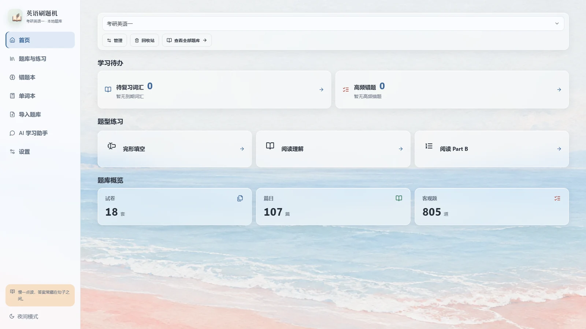
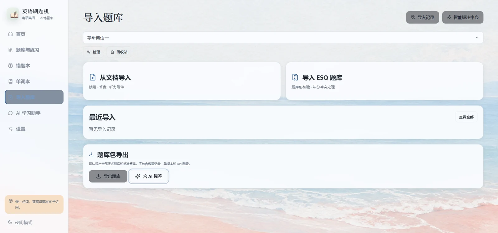
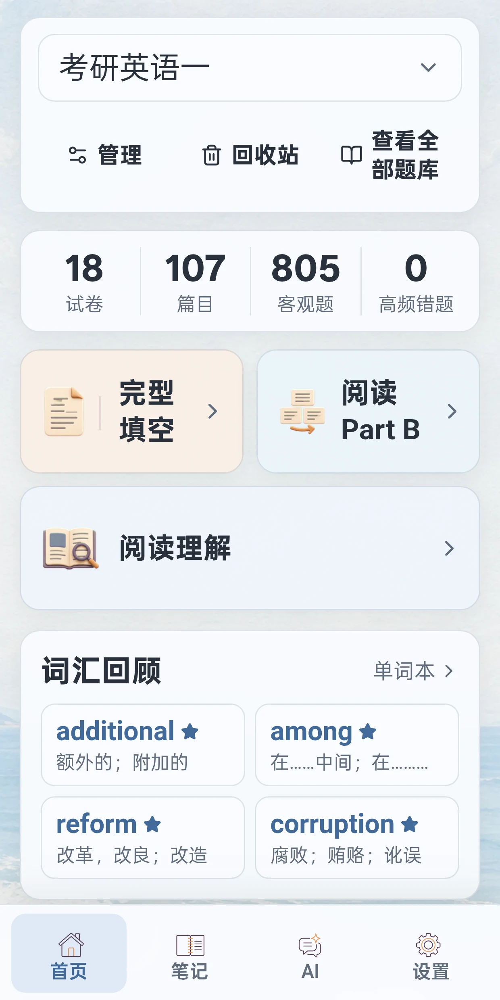
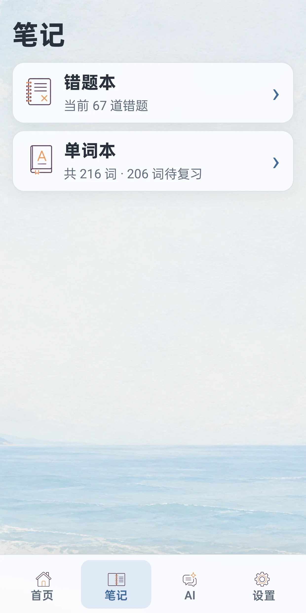
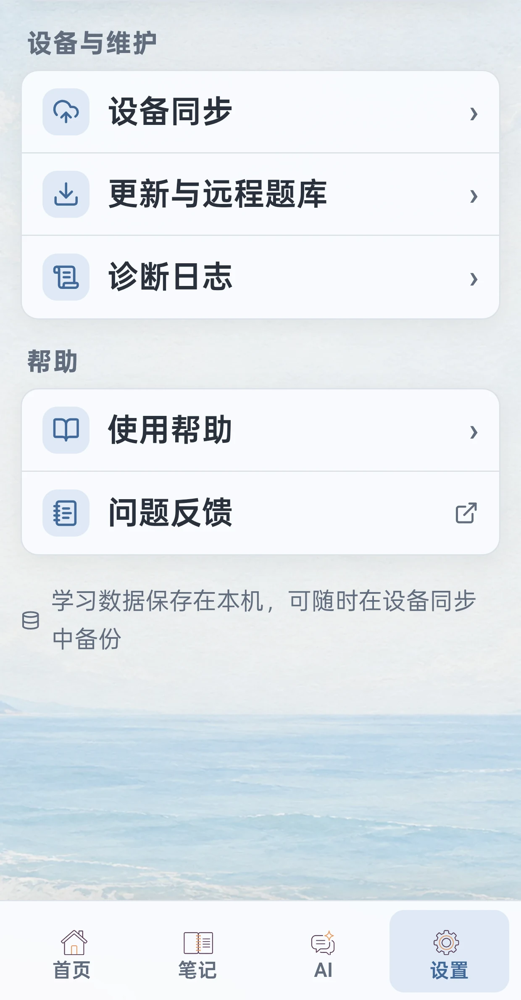
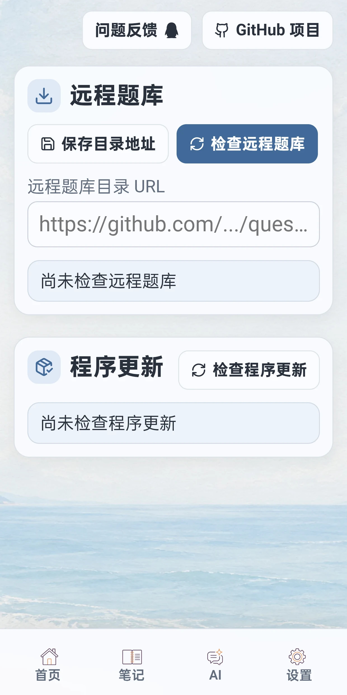
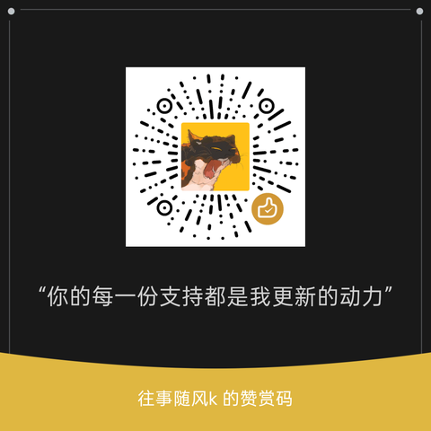

<div align="center">

  

  # 英语刷题机 Android

  **题库自由 · 模型自由 · 数据本地 · 自由刷题**

  面向 Android 手机、平板的英语客观题训练应用

  <p>
    <a href="README.en.md">English</a> ·
    <a href="docs/question-bank-format.md">ESQ 题库格式</a> ·
    <a href="docs/update-manifest.md">更新清单格式</a> ·
    <a href="LICENSE">GPL-3.0-only</a>
  </p>

  <p>
    <a href="https://linux.do/" target="_blank" rel="noopener noreferrer"></a>
    
    
    
    
  </p>

  <p>
    <a href="#sponsor"></a>
    <a href="#support"></a>
  </p>
</div>

英语刷题机 Android 是 Windows 版的独立发行项目。它把题库、模型和练习记录留在本机，让你导入自己的题库、接入自己选择的模型，再用完整篇目、打乱选项和错题重做，把有限的真题反复练出新鲜感。

## 下载 1.0.1

| 平台 | 版本 | 获取方式 |
| --- | --- | --- |
| Android 手机 / 平板 | 1.0.1 | [下载 APK](https://github.com/wssfk12138/android-english-multiple-choice-practice-machine/releases/download/v1.0.1/english-practice-machine-android-1.0.1.apk) · [Release 说明](https://github.com/wssfk12138/android-english-multiple-choice-practice-machine/releases/tag/v1.0.1) |
| Windows 10 / 11 | 1.0.1 | [安装包](https://github.com/wssfk12138/english-multiple-choice-practice-machine/releases/download/v1.0.1/EnglishPracticeMachinePublic-1.0.1-Setup.exe) · [免安装 ZIP](https://github.com/wssfk12138/english-multiple-choice-practice-machine/releases/download/v1.0.1/english-practice-machine-windows.zip) |

> **1.0.1 修复**：在计时模式、听力单元且尚未作答时退出练习，确认“继续退出”后页面会停留在原处、无法离开。现在可以正常返回题库，Windows 与 Android 两端均已修复。

Android 安装包要求 Android 8.0 或更高版本。覆盖安装会保留本地题库与学习记录；首次从其他签名版本切换时，可能需要先卸载旧包。应用内“检查更新”会校验文件大小和 SHA-256，再交给系统安装器确认。

## 横屏与竖屏，各用各的布局

Android 版没有把桌面页面直接缩小。它会根据窗口宽度和屏幕方向切换信息密度：平板横屏使用侧栏与双栏练习，手机和窄窗口使用竖屏信息架构，也支持平板分屏。

- **四项底部导航**：首页、笔记、AI、设置。错题本和单词本集中在笔记，导入、回收站、更新和模型配置集中在设置。
- **首页跟着题库变化**：只显示当前题库真实存在的听力、完形、阅读和 Part B 入口；试卷列表只显示名称，词汇回顾每五秒翻一组。
- **竖屏练习上下分区**：上方文章或听力控制，下方题目与选项，两区独立滚动；中间分隔条可以拖动。
- **横屏练习双栏**：左侧文章或材料，右侧题目和选项；听力使用完整音轨和紧凑播放器。
- **统一主题**：亮色为米白宣纸纹理，暗色为蓝紫油画星空；手机与平板共用 4K 背景并按窗口居中裁切。
- **紧凑工具栏**：退出、计时、答题卡和更多操作使用图标按钮；答题卡从顶部打开，提交按钮集中在底部。
- **问题反馈就在手边**：设置里的“帮助与关于”和“更新与远程题库”都提供问题反馈按钮，更新页同时保留 GitHub 项目入口。

## 界面预览

横屏图取自电脑端实机运行画面，与 Android 平板横屏共用侧栏和双栏布局；竖屏图来自 Android 1.0.1 实机，已裁去系统状态栏与系统导航栏。画面只展示界面与数量概览，不含题目内容、API Key、同步口令或数据库文件。

### 横屏

<table>
  <tr>
    <td align="center"><br><sub>首页 · 侧栏与学习概览</sub></td>
    <td align="center"><br><sub>导入题库 · 文档、ESQ 与题库导出</sub></td>
  </tr>
</table>

### 竖屏

<table>
  <tr>
    <td align="center"><br><sub>首页</sub></td>
    <td align="center"><br><sub>笔记</sub></td>
    <td align="center"><br><sub>设置与问题反馈</sub></td>
    <td align="center"><br><sub>更新与 GitHub 入口</sub></td>
  </tr>
</table>

## 功能

| 模块 | 你能做什么 |
| --- | --- |
| 题库与导入 | 导入 ESQ 1.0/1.1、DOC、DOCX、文本型 PDF 和听力音频；模型只改结构化草稿，逐字段校对后才入库 |
| 练习与判分 | 按年份或随机整篇练习；完形、阅读、Part B、四六级选词填空和段落匹配；选项可打乱，判分使用稳定键 |
| 计时与断点 | 可选计时与暂停；未答题会定位到第一道空缺；未完成会话可在下次继续，断点按题库、篇目和题目集合匹配 |
| 错题本 | 按题库、年份、篇目组织；保留选择历史、高频错题和重做记录；分析结果本地缓存，重做后才允许更新 |
| 单词本 | 文章、题干、选项中长按取词；普通释义与语境释义分开展示；支持复习、编辑、重试翻译和同义/反义/形近词辨析 |
| AI 助手 | 多 API 配置、模型拉取与切换、学习问答、单词翻译、错题建议、导入校正和题目标注；支持四张图片附件 |
| 本地数据 | 题库、练习、错题、单词、聊天和配置保存在本机；API Key 由 Android Keystore/AES-GCM 保护 |
| 更新与隐私 | 检查 GitHub Release，校验大小与 SHA-256 后交给系统安装；诊断日志只在本机保留，支持脱敏导出 |

### 题库与导入

- 默认内置考研英语（一）和考研英语（二）客观题 ESQ 题库，可离线开始练习。
- 首次打开会用一次性引导提示先配置模型与 API、再到“更新与日志”获取所需题库；不使用 AI 时也可以直接使用内置或本地导入的题库。
- 支持 ESQ 1.0/1.1 导入、预览、校验和冲突确认。
- 支持 DOC、DOCX、文本型 PDF 题目与答案附件，以及 MP3/M4A/WAV/OGG 听力音频。
- 导入页支持模型辅助定位题目、题号和答案；模型只修改结构化草稿，用户逐字段校对并批准后才入库。
- 批准入库后可按本次导入、年份或全部题库执行智能标注；听力题不发送给标注模型。
- 扫描版或水印严重、没有可靠文字层的 PDF 会明确提示人工 OCR/整理，不把失败伪装成成功。
- 一个文档目前只导入首套试卷；开始导入前会弹窗提醒，避免多套真题互相错位。
- 选择本地文件或远程题库后，必须明确确认创建新题库配置还是导入既有配置；新配置不会自动切换当前学习题库，预览也可以无损关闭。

### 练习与判分

- 按题库配置、年份练习，或随机抽取完整篇目：完形为一篇文章加题目，阅读/Part B 为一篇材料加该篇题目。
- 支持完形、阅读、Part B、四六级选词填空/段落匹配和听力客观题。
- 可在开始前选择是否打乱选项；判分使用稳定选项键，不受显示顺序影响。
- 可选计时，暂停按钮只暂停计时；未答完时阻止提交并定位到第一道未答题。
- 单篇提交即时显示本篇得分和错题数，整卷提交显示整卷成绩和各篇结果。
- 听力不显示原文、不做错题分析；整段播放、整段提交，退出未完成听力时提示本次记录不保留。
- 普通练习、错题重做和同步回来的未完成会话支持继续作答；断点恢复会匹配同一题库、篇目和题目集合，避免把其他配置的记录错误接续进来。

### 错题本与单词本

- 错题本随当前题库配置筛选，记录每次选择、近期权重、高频错题和重做历史；错误答案回顾不直接显示正确答案。
- 同一篇分析结果缓存到本地；完成下一次错题重做前不重复调用模型，重做后才允许提交新的错误选项快照。
- 文章、题干和选项中长按选词即可加入单词本；加入时不显示翻译，退出答题页或打开单词本后后台处理待翻译词。
- 普通释义优先，语境释义放在“真题中的遇见”旁边；同词重复加入两次及以上显示 `🌟` 高频标记。
- 支持搜索、筛选、编辑、重试翻译、阶段性复习和同义/反义/形近词辨析（默认关闭，可在设置中统一开启）。

### AI 与模型配置

- 保存多个 API 配置，设置 Base URL、API Key、默认模型、Temperature、启用状态和模型选择器显示状态。
- 内置 `openai-chat`、`openai-responses`、`anthropic`、`google`、`kiro` 和 `command-code` 六种协议适配器；可按协议转换消息、图片附件、推理强度和响应文本。
- 自动拉取可用模型并支持模型切换；Ollama、LM Studio 等兼容服务可使用相应的 OpenAI 协议。具体能力仍取决于所选服务和模型。
- AI 可用于学习问答、单词翻译、错题建议、题库导入校正和题目考点标注。
- AI 学习助手支持添加最多 4 张图片附件，自动压缩后随消息发送，仅保存在本机对话记录中；模型不支持图片时会明确提示，不会静默失败。
- API Key 仅通过 Android Keystore/AES-GCM 安全存储；未启用 AI 时基础刷题和判分完全离线可用。

当前验证覆盖六种协议的本地请求/响应契约、推理强度映射和前端构建；尚未向六类真实供应商端点发起请求，因此不能视为全部服务的真实连通性认证。

### 局域网学习记录同步

- 可与同一局域网中的 Windows 版同步练习、错题和单词本等学习记录；题库内容仍通过 ESQ 单独交换。
- Windows 同步主机默认关闭。用户在 Windows 端启用并生成口令后，Android 才能配对；每次握手都必须提交当前口令，口令轮换会立即作废旧令牌，设备也可显式撤销后重新配对。
- 同步按所选题库配置隔离，使用增量游标、删除墓碑和整批事务合并；网络中断可在恢复后继续，同一对象冲突按最后更新时间裁决。
- 地址、口令和设备令牌只保存在用户本机，不写入应用默认配置或题库分享包。

### 更新与隐私

- 点击检查更新后，系统使用 GitHub Release 官方清单；受控 HTTPS 镜像只可由发布构建显式配置，并按顺序自动回退，源码默认镜像列表为空。
- 下载包必须通过文件大小和 SHA-256 校验，再交给 Android 系统安装确认；应用不会静默安装。
- 程序更新、官方题库链和用户填写的第三方题库目录彼此隔离；第三方目录不会成为官方回退源。
- 诊断日志最多保留 50 条且只在本机保存，支持脱敏查看、复制、导出和系统分享；学习历史诊断只输出数量与完整性类别，不包含题库名、题目、答案、词汇或同步标识，也没有自动上传接收端。
- ESQ 包不含 API 配置、API Key、聊天记录、练习记录、错题本或单词本。

## 默认题库

| 题库 | 文件 | SHA-256 |
| --- | --- | --- |
| 考研英语（一）2002、2010–2026（v1.1.0） | `frontend/public/internal-question-bank.esq` | `faebfd9c415d889054b530598f4184f44c17981eaf52bdd0238068b6111d59ba` |
| 考研英语（二）2010–2025（v1.1.2） | `frontend/public/internal-question-bank-english-two.esq` | `9fbf271a5243c8dd0042f9c501dd74e6865ce6639f458460982fe30c326e34c8` |

更多四六级与考研题库可通过[独立题库仓库](https://github.com/wssfk12138/english-question-banks)获取。两份内置题库均为考生回忆整理/本地导出内容，不代表官方试题发布；题库内容、答案和 AI 标签不自动继承程序代码的 GPL 许可，来源和传播权限以包内 `manifest.json` 为准，详情见 [默认题库清单](docs/bundled-question-banks.md)。

## 从源码构建

环境：Windows 10/11、Node.js 22.13 或更新版本、Corepack/pnpm 11、JDK 21、Android Studio、Android SDK Platform 36。

```powershell
cd frontend
corepack.cmd pnpm install
corepack.cmd pnpm run build
corepack.cmd pnpm exec cap sync android
cd android
.\gradlew.bat assembleDebug
```

Debug APK 输出在 `frontend/android/app/build/outputs/apk/debug/app-debug.apk`。正式发布必须使用固定签名、递增 `versionCode`，并单独保管签名文件；APK/AAB、数据库、日志、API Key 和签名材料不得提交到 GitHub。

## 项目边界

Android 与 Windows 使用独立数据库、版本号、签名、提交历史和发布节奏；ESQ 是题库内容的兼容交换边界，可选局域网同步只传递允许的学习记录。Android 的文件导入与模型标注在设备端执行，具体能力受设备性能和用户配置的模型服务影响。

<a id="sponsor"></a>
<h2> FastAI 模型赞助商<br><sub><sup>免费不意味着开发没有成本。感谢 FastAI 的赞助，让功能对所有用户开放。</sup></sub></h2>

如果你正在寻找稳定、实惠的 AI 模型中转服务，可以试试 [FastAI](https://www.fastaitoken.com/register?aff=BF9KNKFHX725&promo=WSSFK)。它提供 DeepSeek、GLM、Kimi、GPT、Claude、Grok 等模型厂商的旗舰模型，也提供图片和视频生成模型；国模分组采用大厂自部署模型，低延迟、高缓存，注册即送 3$ 体验金。

本项目使用 FastAI 提供的模型参与开发。通过下方链接注册或充值，作者会获得返利，用于继续维护项目。 <a href="https://www.fastaitoken.com/register?aff=BF9KNKFHX725&amp;promo=WSSFK"></a>

<a id="support"></a>
<h2>赞助本项目<br><sub><sup>如果它帮你省下了一点整理题库的时间，欢迎请作者喝杯咖啡。</sup></sub></h2>

<p align="center">
  
</p>

## 许可证与作者

程序代码采用 GNU General Public License v3.0 only（`GPL-3.0-only`）。作者：往事随风k。

题库、题目文本、答案、AI 标签和 ESQ 包可以有独立的来源与授权条件；使用或分享前，请确认自己拥有相应权利。
